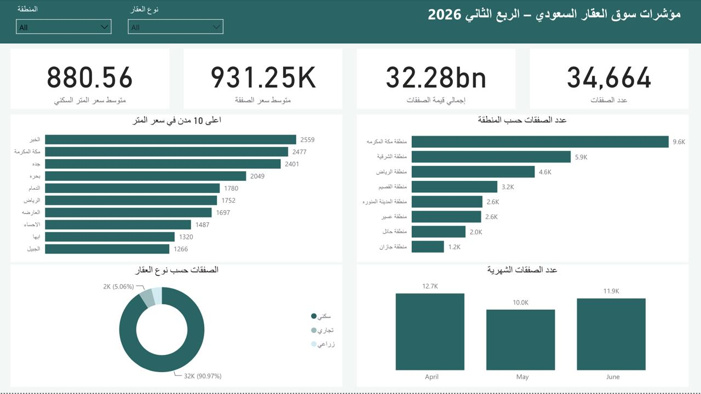
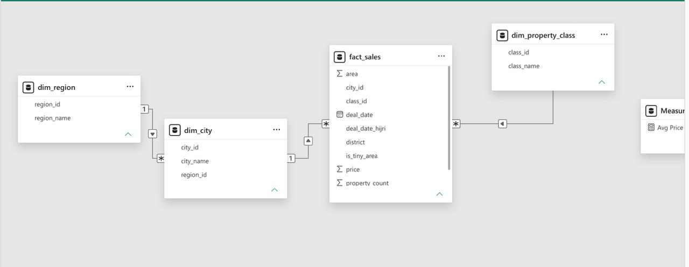

# Saudi Real Estate Sales Analysis (Q2 2026)

SQL Server and Power BI project analyzing real estate sales deals in Saudi Arabia for Q2 2026 (April - June).

## Data
- Source: Ministry of Justice - Saudi Open Data Portal (open.data.gov.sa)
- 34,664 sales deals
- Columns: region, city, district, deal date, property type, price, area

## Tools
- SQL Server (SSMS)
- Power BI

## Steps
1. **Import** - loaded the raw CSV into a staging table with all columns as text.
2. **Data profiling** - checked for nulls, duplicates and outliers. No nulls or duplicates found.
3. **Data cleaning** - removed commas from prices, converted text to numbers and dates, split city and district into separate columns.
4. **Outliers** - found 71 deals with very small areas (less than 20 m²). These look like ownership shares, so I kept them in deal counts but excluded them from price per m² calculations.
5. **Data modeling** - split the data into a fact table and dimension tables (region, city, property class) and linked them with foreign keys.
6. **Analysis** - used JOINs, CTEs and window functions (RANK, LAG, SUM OVER).
7. **Dashboard** - connected Power BI to SQL Server and checked that the numbers match the SQL results.

## Key Findings
- 34,664 deals worth about 32.3 billion SAR in Q2 2026.
- Makkah region had the most deals (27.7%), then Eastern region (17.1%) and Riyadh (13.3%).
- Asir had fewer deals than Madinah, but almost double the total value.
- Most expensive cities by residential price per m²: Al Khobar (2,559), Makkah (2,477) and Jeddah (2,401).
- Most expensive district: Abhur Al Janubiyah in Jeddah (11,898 SAR per m²).
- Deals dropped 21% in May and went up 18% in June.
- 91% of deals are residential, but the average commercial deal is about 8 times higher in price.

## Files
- `sql/01_data_cleaning.sql` - import checks and cleaning
- `sql/02_data_modeling.sql` - fact and dimension tables
- `sql/03_analysis.sql` - analysis queries
- `dashboard/SaudiRealEstate_Q2.pbix` - Power BI dashboard
